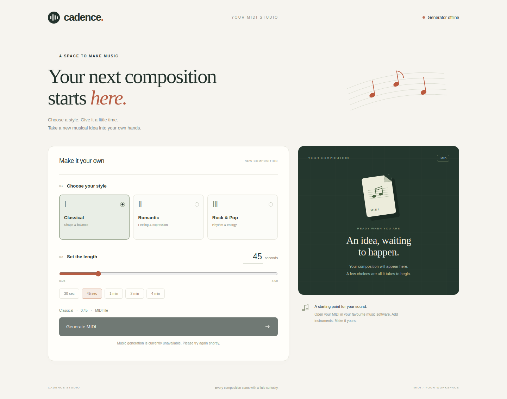

# Cadence — MIDI Generation

Generate MIDI in **Classical**, **Romantic**, or **Rock & Pop** style. Choose a duration in the browser, submit a background generation job, and download the MIDI and its metadata.

Cadence uses a Flask frontend, FastAPI API, and PyTorch Transformer. Local mode runs one background worker inside the API. Docker Compose adds Celery, Redis, Traefik, Prometheus, and Grafana.



*The studio shown without a loaded checkpoint. Generation becomes available when a compatible model is installed.*

## Run locally

Use Python 3.11 or 3.12. From a fresh checkout:

```bash
python3.12 -m venv .venv
.venv/bin/python -m pip install --upgrade pip
.venv/bin/python -m pip install torch==2.6.0 --index-url https://download.pytorch.org/whl/cpu
.venv/bin/python -m pip install -e ".[frontend,api,worker]"
cp .env.example .env
```

Place a compatible checkpoint at **`models/best.pt`**, or set `MUSICGEN_CHECKPOINT_PATH` in `.env`. Trained weights and datasets are kept outside Git. See [checkpoint setup](models/README.md) for the format and [training](docs/training.md) to produce a model.

Run both terminals from the repository root.

**Terminal 1 — API and local generation worker:**

```bash
.venv/bin/python -m uvicorn musicgen.api.main:app --host 127.0.0.1 --port 8000
```

**Terminal 2 — frontend:**

```bash
.venv/bin/python -m flask --app "musicgen.frontend.app:create_app()" run --host 127.0.0.1 --port 5000
```

Open the [studio](http://localhost:5000) or [API documentation](http://localhost:8000/api/docs). Choose a genre and duration, then select **Generate MIDI**. Without a checkpoint, the interface reports generation as unavailable. Restart the API after changing weights. Local job records reset on restart; generated files remain in `storage/generated/`.

## Admin login and Docker monitoring

The studio's **Admin** link opens the shared login for Prometheus, Grafana, and read-only Redis status. Accounts and sessions use a private SQLite database. Redis remains the Celery broker and job store; RabbitMQ is not needed for the current queue.

For local admin access, initialize private settings and create your account interactively:

```bash
.venv/bin/python scripts/manage_admin.py init-env
.venv/bin/python scripts/manage_admin.py create admin
```

For the complete Compose stack, create the account in its persistent database:

```bash
docker compose build frontend
docker compose run --rm --no-deps frontend python scripts/manage_admin.py create admin
docker compose up --build -d
```

| Service | Address |
|---|---|
| Studio | [localhost:8080](http://localhost:8080) |
| API documentation | [localhost:8080/api/docs](http://localhost:8080/api/docs) |
| Admin portal | [localhost:8080/admin/](http://localhost:8080/admin/) |
| Prometheus | [localhost:8080/admin/prometheus/](http://localhost:8080/admin/prometheus/) |
| Grafana | [localhost:8080/admin/grafana/](http://localhost:8080/admin/grafana/) |
| Redis status | [localhost:8080/admin/redis](http://localhost:8080/admin/redis) |

Place the chosen checkpoint at `models/best.pt` before Docker generation. The monitoring tools require the full Compose stack; the two-terminal setup serves the local admin portal at [localhost:5000/admin/](http://localhost:5000/admin/). Dashboard ports 3000/9090 and Redis 6379 are internal. See [admin setup](docs/admin.md) for passwords, persistence and resets, and [operations](docs/operations.md) for metrics and worker restarts.

## Generate from the terminal

```bash
.venv/bin/python scripts/generate.py --checkpoint models/best.pt \
  --genre rock_pop --seconds 60 --seed 42 --device cpu \
  --output storage/generated/example.mid
```

This writes the MIDI and a JSON metadata sidecar, including checkpoint identity, random seed, duration, and generation time.

## Training and evaluation

The current workflow uses **750 MIDI files: 250 per genre**, with separate training, validation, and test splits. It includes a compact CPU training script and a balanced Colab notebook. Preparation, benchmark, smoke-test, resume, and export instructions are in [the training guide](docs/training.md).

The compact CPU run completed 500 epochs and was tested through the real frontend and API. See [evaluation results](docs/evaluation.md) for timings, structural observations, and their limits. Musical quality and genre fidelity also require listening.

The [outputs folder](outputs/README.md) includes one curated **60-second MIDI per genre** from the epoch-500 review, with generation provenance. Regular generation continues to write local files under `storage/`.

## Development

```bash
.venv/bin/python -m pip install -e ".[dev]"
.venv/bin/python -m ruff check src tests scripts
.venv/bin/python -m ruff format --check src tests scripts --exclude src/musicgen/generation/runtime
.venv/bin/python -m pytest -q
.venv/bin/python -m build
```

Optional browser, Redis/Celery, and GPU checks require their dependencies or services. See [development checks](docs/operations.md#development-checks).

## Project guide

```text
src/musicgen/       Application, admin, generation and training code
scripts/            Command entry points and evaluation utilities
notebooks/training/ Current balanced Colab notebook
tests/              Unit and integration checks
docker/             Service images
infra/              Routing, Redis and monitoring configuration
docs/               Operations, admin, architecture and training guides
models/             Checkpoint instructions; weights remain local
outputs/            Three curated one-minute MIDI examples and provenance
```

- [Architecture and API endpoints](docs/architecture.md)
- [Operations and monitoring](docs/operations.md)
- [Training](docs/training.md)
- [Checkpoint setup](models/README.md)
- [Evaluation](docs/evaluation.md)

Source, tests, configuration, the current training workflow, and the curated `outputs/` examples belong in Git. Virtual environments, `.env`, datasets, checkpoints, other generated audio/MIDI, and `storage/` remain local.
