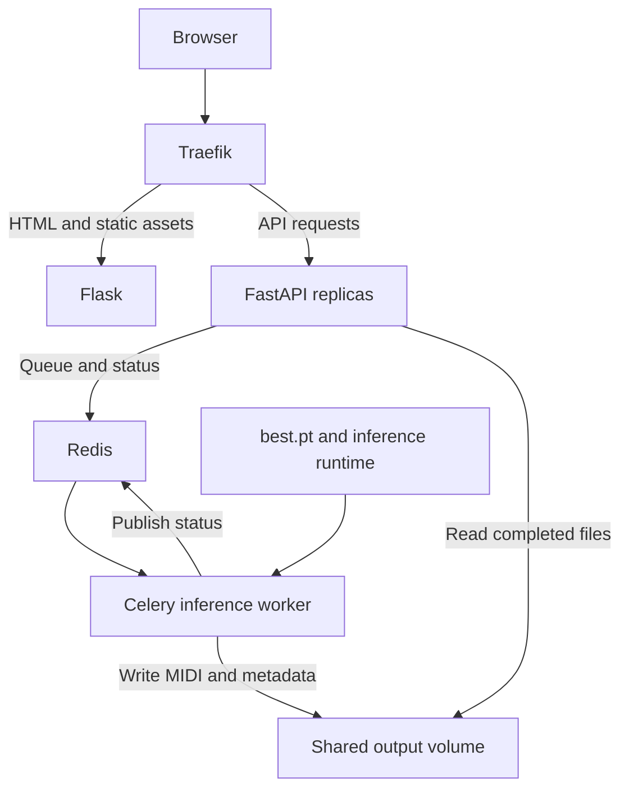

# Architecture and API

Flask renders the Jinja page. In Docker, Traefik routes pages/static assets to Flask and `/api/` to FastAPI at the same origin. FastAPI stores jobs in Redis and submits Celery messages containing only job IDs. A serial inference worker owns the loaded model.



## Run modes

| Mode | Execution | State | Intended use |
|---|---|---|---|
| `local` | One background-thread generator inside one API process | Memory | Local development |
| `distributed` | Separate serial Celery worker | Redis | Compose and API replicas |

Both modes use `MidiGenerator`. PyTorch is imported only when loading a generator. The distributed API and Flask image do not install it. One model processes one job at a time; each additional inference worker needs its own model memory.

## API contract

```json
{"genre": "rock_pop", "duration_seconds": 45}
```

| Endpoint | Behaviour |
|---|---|
| `POST /api/generations` | HTTP 202 with job ID and status URL |
| `GET /api/generations/{id}` | Queued, generating, completed or failed |
| `GET /api/generations/{id}/download` | Completed MIDI attachment |
| `GET /api/generations/{id}/metadata` | Inference metadata JSON |
| `GET /api/config` | Genres and duration bounds |
| `GET /api/health/live` | Process liveness |
| `GET /api/health/ready` | Store and generator readiness |
| `GET /api/docs` | Interactive documentation |
| `GET /api/redoc` | ReDoc documentation |
| `GET /api/openapi.json` | OpenAPI schema |
| `GET /metrics` | Internal Prometheus metrics |
| `GET /docs/oauth2-redirect` | Automatic Swagger OAuth helper |

The documentation, schema and OAuth helper routes also accept `HEAD`. The OAuth helper is outside the proxy's `/api/` routing and is accessible directly on the API port; the application does not currently use OAuth. Metrics are scraped internally in Compose and are available at `http://localhost:8000/metrics` in local mode.

Genres: `classical`, `romantic`, `rock_pop`. Duration must be an integer from 5 to 240 seconds, subject to the configured maximum. The server selects and records a seed. Model paths are not client inputs.

Unknown/expired jobs return 404, unfinished downloads 409, a full queue 429, unavailable queue/store/model 503 and invalid input 422. Actual duration is quantized to the musical grid and recorded in metadata.

## Job integrity

Memory updates use a lock. Redis uses WATCH/MULTI transactions. Only one worker claims a queued record; terminal states do not transition backward. Duplicate messages do not regenerate completed jobs.

The generator writes a partial MIDI, re-reads it for note integrity, then publishes the final file. Metadata is written before marking the record completed. Output paths use validated, server-generated job IDs.

A generating job whose worker disappears is reported failed when polled after heartbeat expiry and the 30-second grace period. Submit a new request; automatic recovery of interrupted music generation is not promised.

Queue records have seven-day retention by default. Local records reset on restart. Compose Redis uses persistent AOF storage. Generated file cleanup is manual; expiry of a job record does not delete its files.

## Monitoring

Prometheus discovers and scrapes each service replica directly. Grafana provisions two dashboards from version-controlled JSON.

| Metric | Owner |
|---|---|
| `musicgen_http_requests_total` | Flask/API |
| `musicgen_http_request_duration_seconds` | Flask/API |
| `musicgen_queue_jobs` | API reading shared state; use max across replicas |
| `musicgen_worker_ready` | Worker |
| `musicgen_worker_active_jobs` | Worker |
| `musicgen_generation_jobs_total` | Worker, genre/outcome |
| `musicgen_generation_duration_seconds` | Worker |
| `musicgen_queue_wait_seconds` | Worker |
| `musicgen_model_load_seconds` | Worker |

HTTP labels use route templates. Job IDs belong in logs/JSON metadata. Process CPU and memory are exposed. GPU hardware telemetry and alert notification delivery are not configured in this initial version.

## Administrator access

Flask owns the admin UI and a small SQLite identity database. The database stores salted scrypt password hashes, hashed opaque session tokens, expiry times and login-throttling records. Accounts are created/reset by an interactive CLI, not through public registration. Local storage defaults to `storage/admin/admin.sqlite3`; Compose mounts the private `admin_data` volume into the frontend. Each operation opens its own SQLite connection for the single-host threaded frontend.

The studio's Admin link leads to `/admin/`. A signed-in administrator can open Prometheus, Grafana and read-only Redis status there. These Flask routes are separate from FastAPI and do not appear in its Swagger schema:

| Method | Route | Purpose |
|---|---|---|
| GET, POST | `/admin/login` | Sign-in form and credential verification |
| GET | `/admin/` | Protected tool landing page |
| POST | `/admin/logout` | CSRF-protected session revocation |
| GET | `/admin/auth` | Traefik session check and verified username response |
| GET | `/admin/redis` | Protected read-only server/job statistics |
| Tool methods | `/admin/prometheus/…` | Protected Prometheus UI/API through Traefik |
| Tool methods | `/admin/grafana/…` | Protected Grafana UI/API through Traefik |

Traefik strips incoming identity/Authorization headers, calls `/admin/auth` with the session cookie and forwards only the server-verified username. The authentication middleware applies to all tool paths, including APIs and assets. Grafana's auth proxy accepts this identity only from Traefik's configured address on a dedicated tool network. Native Grafana basic/anonymous login is disabled, and tool ports are not published directly.

Redis uses a separate machine password and named ACL account for Celery broker messages, results and job storage. Browser administrators do not log into Redis directly. The portal's Redis page publishes only selected read-only statistics. See [admin setup](admin.md) for setup, resets and persistence.

The music-generation API remains public within the configured local/Compose exposure. Administrator login protects operational tools; it does not add end-user accounts or authentication to generation endpoints.

## Training and deployment boundaries

The services never train or read the dataset CSV. The current training workflow consists of the balanced CPU command runner and the balanced Colab notebook in `notebooks/training/`; both export compatible checkpoints. See [training](training.md). Inference modules preserve the Experiment 9 vocabulary and state-dict parameter names; provenance records the original source.

Compose targets one Docker host. Multi-host deployment requires shared network/object storage and suitable queue availability. Published ports bind to loopback. Public hosting, music-API authentication and TLS remain separate deployment work. The shared admin portal is a single-host operational login, not a general user-account system.

## Primary references

- [Flask deployment](https://flask.palletsprojects.com/en/stable/deploying/gunicorn/)
- [FastAPI lifespan](https://fastapi.tiangolo.com/advanced/events/)
- [Celery signals](https://docs.celeryq.dev/en/stable/userguide/signals.html)
- [Traefik Docker provider](https://doc.traefik.io/traefik/reference/install-configuration/providers/docker/)
- [Compose GPU support](https://docs.docker.com/compose/how-tos/gpu-support/)
- [Prometheus configuration](https://prometheus.io/docs/prometheus/latest/configuration/configuration/)
